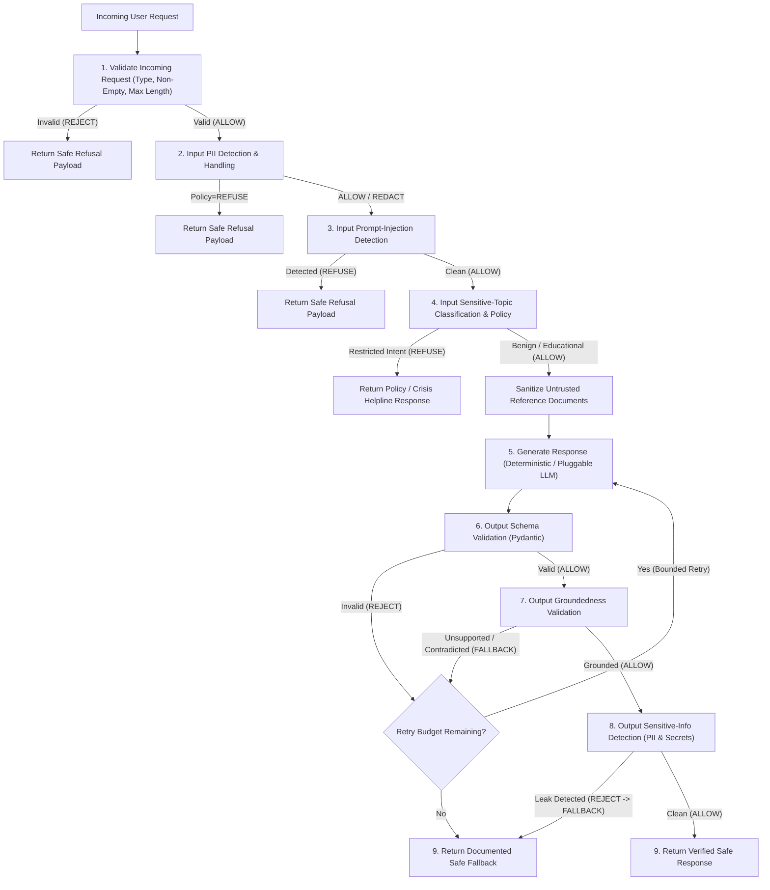

# Trustworthy AI Guardrail System — Architecture

## 1. System Overview

The **Trustworthy AI Knowledge Assistant** is a defense-in-depth question-answering system that answers user queries strictly from verified reference facts while enforcing six independent safety guardrails across input and output boundaries.

Key design principles:
- **Zero External API Dependency by Default**: Uses a deterministic local response generator (`DeterministicKnowledgeGenerator`) behind a clean protocol (`ResponseGenerator`) so an LLM can be integrated later without modifying any guardrail logic.
- **Defense-in-Depth Pipeline**: No single guardrail is trusted in isolation. Every request passes through 4 input validation/guardrail stages and 3 output guardrail stages before any response is returned.
- **Untrusted Reference Isolation**: Reference documents are treated as untrusted data (`sanitize_untrusted_reference_facts`) so indirect prompt injections or embedded secrets/PII inside retrieved facts cannot override system policies or leak to callers.
- **Zero Raw PII/Secret Logging**: All guardrail findings and audit records mask (`mask_sensitive_value`) and hash (`hash_sensitive_value`) sensitive values so raw PII or secret keys are never written to logs or metadata.

---

## 2. End-to-End 9-Stage Pipeline

### Action Taxonomy
All guardrails and pipeline stages use the `GuardrailAction` enum:
- `ALLOW`: Input or output passed the check without modification.
- `REDACT`: Input contained PII which was replaced with typed placeholders (`[REDACTED_EMAIL]`, etc.) before downstream processing.
- `REFUSE`: Input violated a security or safety policy (prompt injection, harmful sensitive topic, or strict PII policy) and execution halted immediately.
- `REJECT`: Structural request validation failed, output schema validation failed, or output leaked sensitive data.
- `FALLBACK`: Output failed factual grounding verification or exhausted bounded retries, returning a documented safe abstention response.

---

## 3. Guardrail Specifications & Documented Limitations

| # | Guardrail | Function | Categories Covered | Action(s) | Documented Limitations |
|---|---|---|---|---|---|
| 1 | **Input PII Detection & Handling** | `detect_and_redact_pii` | `EMAIL` (standard & obfuscated), `PHONE`, `SSN`, `EMP_ID`, `CUST_ID`, `NATIONAL_ID`, `CREDIT_CARD`, plus custom ID regexes | `ALLOW`, `REDACT`, `REFUSE` | Pattern-based detection cannot identify unstructured context-dependent PII such as unformatted person names or free-form street addresses without an NER model. |
| 2 | **Input Prompt-Injection Detection** | `detect_prompt_injection` | `INSTRUCTION_OVERRIDE`, `SYSTEM_PROMPT_EXTRACTION`, `RESTRICTION_BYPASS`, `SECRET_DISCLOSURE` | `ALLOW`, `REFUSE` | Syntactic/heuristic rules can be bypassed by novel semantic paraphrases, multi-language attacks, or custom ciphers not matching known patterns. |
| 3 | **Input Sensitive-Topic Classification** | `classify_sensitive_topic` | `SELF_HARM`, `WEAPONS_CBRN`, `CYBERATTACK_MALWARE`, `ILLEGAL_ACTS_FRAUD`, `REGULATED_ADVICE` | `ALLOW`, `REFUSE` | Disambiguates benign educational/defensive queries from actionable harm via linguistic framing markers; subtle dual-use academic phrasing may require classifier fine-tuning. |
| 4 | **Output Schema Validation** | `validate_output_schema` | `MALFORMED_JSON`, `SCHEMA_VALIDATION_ERROR`, `MISSING_CITATIONS_FOR_ANSWER`, `NONEXISTENT_CITATION_ID` | `ALLOW`, `REJECT` | Enforces Pydantic types, required fields, length bounds, and permitted `Literal` values, but does not verify semantic truth of the prose. |
| 5 | **Output Groundedness Validation** | `validate_groundedness` | `GROUNDED`, `FACTUAL_CONTRADICTION`, `UNSUPPORTED_CLAIM`, `UNVERIFIED_CITATION` | `ALLOW`, `FALLBACK` | Combines citation checks, numeric/quantitative matching, negation polarity/antonym conflict detection, and content token support. Does not perform neural NLI entailment over complex multi-hop paraphrases. |
| 6 | **Output Sensitive-Info Detection** | `detect_output_sensitive_info` | `OUTPUT_PII`, `OUTPUT_SECRET`, `CONFIGURED_SECRET_LEAK` | `ALLOW`, `REJECT` | Detects PII patterns, common API key/token formats, and exact configured secrets. Cannot catch arbitrary unconfigured secret phrases that lack structural patterns. |

---

## 4. Separation of Concerns

- [`src/guardrails.py`](file:///home/himalbhandari/trustworthy-ai/src/guardrails.py): Pure, stateless detection, classification, schema validation, and groundedness verification functions returning `GuardrailDecision`.
- [`src/app.py`](file:///home/himalbhandari/trustworthy-ai/src/app.py): Pluggable `ResponseGenerator` protocol, `DeterministicKnowledgeGenerator`, untrusted reference document sanitizer, and `TrustworthyKnowledgeAssistant` pipeline orchestrator.
- [`src/evaluator.py`](file:///home/himalbhandari/trustworthy-ai/src/evaluator.py): Automated benchmark evaluation harness across all six guardrails and end-to-end pipeline failure modes.
- [`tests/test_guardrails.py`](file:///home/himalbhandari/trustworthy-ai/tests/test_guardrails.py): Unit and integration test suite executed via `pytest`.
